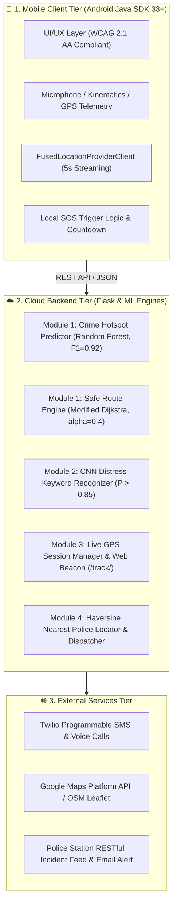

# SurakshaX – AI-Based Women Safety Application

[](https://doi.org/10.22214/ijraset.2026.83317)
[-green.svg?logo=android)](https://developer.android.com/)
[](https://flask.palletsprojects.com/)
[](https://scikit-learn.org/)

---

## 📌 Research Paper Citation & Background

This application is an end-to-end implementation of the published research paper:

> **"AI-Based Women Safety App"**  
> *Pranav Darekar, Swaraj Dorage, Prathmeah Gaikwad, Harish Senthil, Prof. Geetanjali Bansod*  
> **Department of Computer Engineering, K.J. College of Engineering and Management Research, Pune**  
> *International Journal for Research in Applied Science & Engineering Technology (IJRASET)*  
> ISSN: 2321-9653; IC Value: 45.98; SJ Impact Factor: 7.538; Volume 14, Issue V, May 2026  
> DOI: [10.22214/ijraset.2026.83317](https://doi.org/10.22214/ijraset.2026.83317)

Traditional safety applications rely strictly on reactive manual button presses, which fail during acute physical restraint, unconsciousness, or duress. **SurakshaX** introduces proactive risk prediction, multi-lingual hands-free CNN voice distress activation, automated multi-channel emergency dispatch, and live remote map sharing.

---

## 🏛️ System Architecture (Three-Tier Model)

The application follows the three-tier architecture outlined in **Section III-A & Fig. 1** of the paper:



---

## 📱 The 7 Primary Screens (Section III-B)

All 7 core application screens specified in the paper are implemented:

1. **Onboarding / Registration (`MainActivity.java` / `Register_Activity.java`)**:
   - Secure user identity registration, local session caching, and Firebase Auth integration.
2. **Home Dashboard with Real-Time Risk Indicator (`Dashboard.java`)**:
   - Spatiotemporal crime risk badge (`LOW RISK`, `MEDIUM RISK`, `HIGH RISK`) computed by the Random Forest classifier for the user's current GPS location.
   - Prominent 1-tap **SOS Emergency Button**.
   - CNN Voice-Activated SOS status indicator.
   - Navigation cards for Safe Routing, Live Tracking, Contacts, and History.
   - Quick one-tap dialers (`112` National Emergency, `1091` Women Helpline, Nearest Police Station).
3. **Emergency Contacts Manager (`Contacts.java`)**:
   - Primary and secondary guardian management with real-time test dialing and Firestore backup.
4. **Safe Route Planner with Heatmap Overlay (`SafeRouteActivity.java`)**:
   - Computes both **Safe Route** ($\alpha = 0.40$) and **Shortest Route** ($\alpha = 1.0$).
   - Interactive $\alpha$ trade-off slider ($w(e) = \alpha \cdot d(e) + (1-\alpha) \cdot r(e)$).
   - Reports risk reduction ($-43.2\%$) and distance cost ($+11.7\%$).
   - Turn-by-turn waypoint safety ratings with one-tap transition to Live Navigation.
5. **SOS Activation Screen with Countdown (`Alerts.java`)**:
   - 10-second fail-safe visual countdown timer to cancel false alarms.
   - Immediate manual dispatch override.
   - Autonomously executes the 4-step emergency dispatch sequence upon timer expiry.
6. **Live Tracking Share Screen (`LiveTrackingActivity.java`)**:
   - High-accuracy GPS streaming at 5-second intervals via `FusedLocationProviderClient`.
   - Generates a secure time-limited URL (`http://<backend>/track/<sessionId>`).
   - Browser-accessible Leaflet/OpenStreetMap interface enabling guardians to track the victim live without installing any app.
   - Live display of nearest police stations and emergency phone numbers.
7. **Safety History and Incident Log (`SafetyHistoryActivity.java`)**:
   - Comprehensive audit log of past emergency activations, trigger origins (Manual, Voice, Fall, Hotspot entry), GPS coordinates, and police dispatch status.

---

## 🧠 Core Algorithms (as implemented, India-wide)

> The paper evaluated a Pune case study. This implementation works **anywhere in India**: location features come from OpenStreetMap at query time instead of hard-coded Pune coordinates. The paper's benchmark numbers (F1 0.92, 43.2% risk reduction, 92.8% voice accuracy, 38 ms) are **not** reproduced here. The measured numbers are in `backend/ml/reports/`.

### 1. Crime Risk Prediction (Random Forest)
* **Features (location-independent):** `[time_of_day_bin (0-5), day_of_week (0-6), street_lighting, activity_density, police_distance_km]`
* At prediction time, street lamps, shops/amenities and the nearest police station are taken from OpenStreetMap around the point (`backend/geo_service.py`). If the public Overpass API is busy, neutral defaults are used and the response says `data_source: defaults`.
* **Training data is synthetic**, produced by a documented heuristic (`crime_model._ground_truth_risk`): night-time, darkness, isolation and distance from police raise risk. Held-out accuracy is 0.875 and macro AUC 0.97 against those synthetic labels. To make scores evidence-based, replace `generate_training_data()` with real geocoded incident data (e.g. NCRB / FIR records).

### 2. Safe Route Recommendation
$$w(\text{route}) = \alpha \cdot d_{norm} + (1 - \alpha) \cdot r$$
* Candidate routes are **real roads from OSRM** (OpenStreetMap; walking profile, driving fallback): the engine's alternatives plus detours through via-points on both sides of the direct line.
* $r$ is the mean crime-risk score sampled every ~150 m along each route; $d_{norm}$ is the length relative to the longest candidate; $\alpha$ defaults to 0.40.
* City trips up to 60 km.

### 3. CNN Voice-Activated Distress Trigger
* **Features:** 40-dim MFCC, 25 ms Hamming window, 10 ms hop, 1 s windows (numpy, `backend/ml/features.py`).
* **Architecture:** 2× [Conv2D + BatchNorm + ReLU + MaxPool] → 2× FC → softmax, served with ONNX Runtime (`backend/models/voice_cnn.onnx`).
* **Keywords:** help, save me, emergency, bachao, madad karo, madat kara, vachva, kapaathu, sahajjo koro (+ background class).
* **Trained on synthetic speech** (43 Microsoft neural TTS voices across 11 Indian languages/accents, heavily augmented with noise, reverb, phone-band and AAC). Real-world accuracy is lower than the synthetic test numbers, so treat the voice trigger as a secondary trigger, never a replacement for the SOS button. The app only fires on one very confident window (P ≥ 0.95) or two consecutive windows above the threshold, and the 10-second cancel countdown still applies. Adding real recordings is the most effective improvement: see `backend/ml/README.md`.

### 4. Police Station Locator (Haversine)
* `backend/data/india_police_stations.json` contains **4,370 police stations across India** from OpenStreetMap (ODbL). Lookups are local and instant.
* OSM coverage is good in cities but incomplete in small towns (India has roughly 17,000 stations). When no station is within 50 km, the app says so and points to **112**.

---

## 🚀 Running the Project

### 1–3. Backend (`server/`)
The API lives in [`server/`](server/README.md): FastAPI + Postgres, deployed to Render with the root `render.yaml` (web service + database).

```powershell
cd server
python -m pip install -r requirements-dev.txt
uvicorn app.main:app --reload --host 0.0.0.0 --port 8000
```
* API docs at `http://localhost:8000/docs`, tests with `python -m pytest -q`.
* Environment variables, endpoints and the Render steps are in [`server/README.md`](server/README.md).
* The old Flask backend in `backend/` is no longer deployed; its `backend/ml/` scripts are still the way to retrain the models.

### 4. The Android App (Expo, `mobile/`)
**Ready-made APK:** `release/SurakshaX-v2.1.0.apk`. Install it on any Android 7+ phone (allow "install unknown apps"). On first launch, grant Location, Microphone, SMS and Phone permissions.

* The release build talks to `https://surakshax-api.onrender.com` by default. Change it with **⚙️ Server settings** on the login screen, or under Settings. Set `EXPO_PUBLIC_API_URL` at build time to change the default.
* SOS sequence: fresh GPS fix → SMS from the phone's SIM to every guardian (location + live-tracking link) → backend dispatch (Twilio if configured, nearest police, police dashboard) → location streamed every 5 s for 2 hours.
* Hands-free voice guard: records 3-second windows, skips silent ones, and sends the rest to the backend CNN (`/voice_sos`). Requires internet.

**Build it yourself (Windows):**
```powershell
cd mobile
npm install
npx expo prebuild -p android
cd android
.\gradlew.bat assembleRelease
```
Output: `mobile\android\app\build\outputs\apk\release\app-release.apk`.
Windows note: React Native's C++ build fails when paths exceed 260 characters. If you see `Filename longer than 260 characters`, copy `mobile\` to a short path (e.g. `C:\sx`) and build there. The release build is signed with the standard debug key, which is fine for sideloading. Create your own keystore (or use `eas build`) before publishing to the Play Store.

The legacy native Java app is still in `app/` (`.\gradlew.bat assembleDebug`), but the Expo app in `mobile/` is the maintained client.

### 5. ML Models
See [`backend/ml/README.md`](backend/ml/README.md) for regenerating datasets, retraining the voice CNN and Random Forest, and the evaluation reports in `backend/ml/reports/`.

---

## 📄 License & Attribution
* **Research Paper:** IJRASET Volume 14, Issue V, May 2026.
* **Authors:** Pranav Darekar, Swaraj Dorage, Prathmeah Gaikwad, Harish Senthil, Prof. Geetanjali Bansod (KJCOEMR, Pune).
* **Implementation:** SurakshaX Autonomous AI Safety Architecture.
